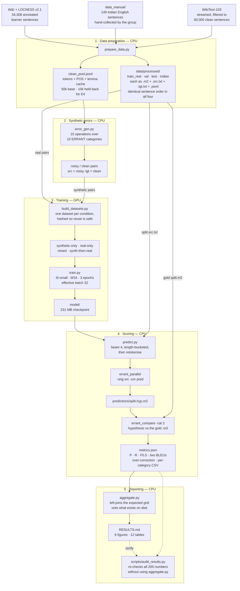

# Fake Errors, Real Grammar

**Can synthetic errors teach a small model to correct real (and Indian English) grammar?**

NLP IA Activity 2 — Mini-Project Implementation and Experimental Evaluation
Course: 316P07E123 Natural Language Processing, FY MTech Computer Engineering,
K. J. Somaiya School of Engineering
Group: Suryoday Kumar Saroj (16030726001), Aryan Gole (16030726006), Meet P Joysar (16030726016)
Faculty: Dr. Grishma Sharma

> **Just want to run the demo?** Read **`HOW_TO_RUN.md`** in this folder instead - a step-by-step walkthrough with the exact commands, what you should see after each one, and a troubleshooting table. It is deliberately **not** in version control: it hardcodes this machine's interpreter path, which would be wrong on anyone else's. The install and reproduce sections below are the portable version.

---

## What this is

Three papers motivated this project. Pan & Cao (2021) correct only detected
errors; Koo et al. (2023) study data-centric tricks but train **only** on
synthetic data and measure with BLEU; Wang et al. (2024) argue synthetic data
helps when it *matches* the real error distribution.

**The gap:** no paper compares synthetic-only, real-only and mixed training on
the same task with the same metric. That comparison is this project.

We build a rule-based error generator, fine-tune `t5-small` as a grammar
corrector under each data condition, and score everything with ERRANT
P/R/F0.5 — plus a copy baseline that shows why BLEU is the wrong metric here.

| Experiment | Question |
|---|---|
| **E0** | Copy baseline. BLEU looks high while F0.5 is 0 — is BLEU fair for GEC? |
| **E1** | Is there a best synthetic noise level `p`? (+ an extra arm testing whether the generator's skewed error mix holds synthetic data back) |
| **E2** | Do identity (already-correct) pairs reduce over-correction? |
| **E3** | **The main comparison:** can synthetic data replace real data, or only supplement it? |
| **E4** | Does matching the real error-type distribution help? |
| **E5** | How do models trained on European learner data handle Indian English? |

Current results live in [results/RESULTS.md](results/RESULTS.md) — every number
there was read from a file this code wrote, and anything not yet run says `TBD`.

---

## Environment

Python 3.10 or 3.11. **On the development machine three things are not
negotiable**, and skipping them produces confusing failures rather than clear
ones:

```powershell
$PY = "C:\Users\91942\miniconda3\envs\gec\python.exe"
$env:PYTHONNOUSERSITE = "1"
$env:PIP_CONFIG_FILE  = "nul"
```

1. **`python` and `pip` on PATH are MSYS2 and have no pip at all.** Always
   invoke `$PY` explicitly.
2. Without `PYTHONNOUSERSITE=1`, `python -m pip` picks up a **broken** pip
   23.1.2 from `%APPDATA%\Roaming\Python\Python310` and dies with
   `ValueError: Unable to find resource t64.exe`.
3. Without `PIP_CONFIG_FILE=nul`, every install wastes five DNS retries on
   `pypi.ngc.nvidia.com`, a dead host in the machine-wide `pip.ini`. Note that
   `pip --isolated` does **not** help: it ignores *user* config but still reads
   the global file.

### Install

```powershell
& "C:\Users\91942\miniconda3\Scripts\conda.exe" create -y -n gec python=3.10
& $PY -m pip install --no-warn-script-location torch==2.6.0 --index-url https://download.pytorch.org/whl/cu124
& $PY -m pip install --no-warn-script-location -r requirements.txt
& $PY -m spacy download en_core_web_sm
```

`torch` is deliberately **absent** from `requirements.txt`: listing it there
would pull the CPU-only wheel from PyPI and clobber the CUDA build. The spaCy
model is also separate — **errant 3.x does not install `en_core_web_sm`**,
despite what `PROJECT_SPEC.md` §3 says.

### Verify the install in one line

```powershell
& $PY -c "import errant; a=errant.load('en'); print([(e.o_str,'->',e.c_str,e.type) for e in a.annotate(a.parse('He go to school .'), a.parse('He goes to school .'))])"
# expected: [('go', '->', 'goes', 'R:VERB:SVA')]
```

That single line proves spaCy, the model, errant and its alignment classifier
all work together.

---

## Reproduce everything

```powershell
# 1. Data. W&I+LOCNESS is ~6 MB; the WikiText pool streams and stops at 60k
#    sentences (~60-90 MB) rather than downloading the full ~250 MB split.
& $PY -m gec.prepare_data --wi
& $PY -m gec.prepare_data --wikitext
& $PY -m gec.prepare_data --inspect     # verifies the alignment invariants

# 2. Tests, then the smoke plan. The smoke test MUST pass before any GPU run.
& $PY -m pytest -q
& $PY -m gec.run_experiments --plan smoke --yes

# 3. Measure throughput (~10 min) so the budget stops being guesswork.
& $PY -m gec.run_experiments --plan e1 --timing-probe

# 4. Inspect before committing GPU time. Make this a habit.
& $PY -m gec.run_experiments --plan all --dry-run

# 5. Run the grid. Selection between plans is automatic and val-only.
& $PY -m gec.run_experiments --plan e0 --yes
& $PY -m gec.run_experiments --plan e1 --yes
& $PY -m gec.run_experiments --plan e2 --yes
& $PY -m gec.run_experiments --plan e3 --yes
& $PY -m gec.distribution --match
& $PY -m gec.run_experiments --plan e4 --yes

# 6. Tables, figures and RESULTS.md.
& $PY -m gec.evaluate --latency --run results/runs/e3_real/seed13
& $PY -m gec.aggregate
& $PY scripts/audit_results.py    # re-checks every number against metrics.json

# 7. The demo.
& $PY app/app.py
```

No GPU? `notebooks/colab_run.ipynb` does the same on Colab, with results on
Google Drive so a disconnect costs at most one run. Note that a free **T4 is
compute capability 7.5 — no bf16, no TF32**, so it is roughly as fast as an
RTX 3050 in bf16; Colab's value is a second machine, not a speedup.

---

## How it works



Read it as five stages, each a different kind of work:

| Stage | Cost | Produces |
|---|---|---|
| 1. Data preparation | ~15 min CPU, once | the four splits and the POS-tagged clean pool |
| 2. Synthetic errors | seconds per dataset | noisy/clean training pairs |
| 3. Training | 9–28 min per run on an RTX 3050 | one checkpoint |
| 4. Scoring | ~11 min per run | `metrics.json`, the only thing the report reads |
| 5. Reporting | seconds | `RESULTS.md`, figures, tables — plus an independent audit |

Two properties of this pipeline matter more than the rest of it put together.
**ERRANT is the only scorer**, driven through its own CLI rather than
reimplemented, so our numbers are comparable with published GEC work. And
**`metrics.json` is the single source of truth**: nothing downstream of stage 4
ever recomputes a score, which is what makes the stage-5 audit meaningful
rather than circular.

### Things worth knowing before you change anything

**The generator corrupts clean text, so the training pair is
`src = noisy, tgt = clean`.** The edit log describes clean→noisy, i.e. the
inverse of what the model learns. This is the easiest thing in the project to
get backwards, and `distribution.py` depends on getting it right.

**Predictions are re-tokenised before scoring.** T5 drifts toward ordinary
detokenised English and emits `information.` where the source had
`information .`. ERRANT cannot distinguish that surface convention from a real
`PUNCT` edit — it affected 48 of 50 smoke predictions — so
`predict.retokenise()` restores the project convention first.

**The `val` reference M2 is a verbatim slice of the training M2.**
`M2Block.raw` preserves the original block text, so `val.m2` carries the
*original* gold annotations rather than edits re-derived by ERRANT. Re-deriving
them would differ in merge and classification decisions and make `val` scores
incomparable with `test` scores — and E1/E2 selection depends on exactly that
comparability.

**Hyperparameter selection cannot touch the test set.** `aggregate.select_best`
has a hard assertion refusing to read any `test` metric, experiment YAMLs
reference `${select.e1_best_p}` rather than hardcoded numbers, and
`selection.json` records every candidate's **val** score so the choice is
auditable.

**Every reported number is re-checked against the run that produced it.**
`scripts/audit_results.py` parses the rendered `RESULTS.md`, re-reads each
`metrics.json` (following `alias_of` pointers), and compares every cell -
without going through `aggregate.py` at all. It also verifies that every linked
figure and table exists. It currently checks **200 numbers** - including the
three-seed means, the paired deltas and the same-sign column - and exits
non-zero on any mismatch; `tests/test_audit_results.py` doctors single cells to
prove the auditor can actually fail.

**No module calls bare `open()`.** Python 3.10 on Windows defaults to cp1252
and the W&I essays are full of curly quotes and accents. Everything goes
through `paths.read_text` / `paths.write_lines`, which also refuses to write a
blank line — ERRANT's `parallel_to_m2` does `if not orig: continue` and would
silently drop it, desynchronising the M2 files.

**ERRANT is never reimplemented for scoring.** `errant_compare` is the scorer.
`evaluate.score_m2_pure_python` is an independent reimplementation used *only*
as a cross-check: it must agree within 0.005, which makes the stdout parsers
self-validating. If a future ERRANT changes its output format, the assertion
fires loudly instead of silently producing wrong numbers.

---

## Layout

```
configs/
  base.yaml                 every key, with defaults; validate_config rejects unknown keys
  experiments/*.yaml        one per run family (generated by scripts/make_configs.py)
  plans/smoke.yaml          CPU smoke overrides
src/gec/
  paths.py                  every path + UTF-8/LF-only I/O
  repro.py                  seeds, git state, library versions, device info
  m2.py                     M2 parse/apply/write; the raw round-trip
  tok.py                    tokenisation, POS tagging, the T5 <unk> guard
  prepare_data.py           W&I download/split, WikiText pool, Indian English
  error_gen.py              15 corruption operations over 10 ERRANT categories
  build_datasets.py         synthetic / real / mixed JSONL
  train.py                  fine-tune t5-small (bf16 gated on compute capability)
  predict.py                batch inference, length-bucketed, re-tokenised
  errant_cli.py             ERRANT subprocess wrapper (PYTHONUTF8, -c entrypoints)
  evaluate.py               ERRANT + sacreBLEU + over-correction + latency
  distribution.py           E4 matching, and the pre-compensated E1 arm
  kappa.py                  Indian English validation + annotator agreement
  explain.py                ERRANT category -> plain-English reason
  run_experiments.py        resumable plan runner with the budget gate
  aggregate.py              tables, figures, RESULTS.md (TBD-safe)
app/app.py                  Gradio demo, 3 models side by side
notebooks/colab_run.ipynb   the same pipeline on Colab
data_manual/                Indian English template + instructions for the group
```

`PROGRESS.md` is the running log: phase status, measured dataset sizes, every
deviation from the spec and why, and the open issues.

---

## The Indian English test set

This is the one part the group writes by hand, deliberately, so E5 stays a
human-made evaluation set. The repo ships the template, the validator, the
agreement tooling and exactly five `EXAMPLE-` rows showing the format — the 150
real sentences are ours to write. See
[data_manual/README.md](data_manual/README.md). Below 20 real rows, E5 skips
gracefully and reports `TBD`.

---

## Known limitations

- **Domain mismatch.** The clean pool is Wikipedia; the real data is learner
  essays. Corrupted Wikipedia prose does not read like a learner error, and
  this is a known confound in the synthetic-only condition.
- **The generator covers 10 ERRANT categories; 22.6% of real W&I edits are in
  categories it cannot produce at all** (WO, MORPH, NOUN:POSS, CONTR,
  VERB:INFL). That bounds what synthetic-only training can reach here.
- **Verb errors are structurally hard to synthesise.** 15.8% of real edits are
  verb errors against 4.2% of ours, because `sva` can only fire where an
  eligible verb exists. Pre-compensation roughly quadruples them and still
  falls short of parity.
- **`t5-small` scores far below published GEC systems** (which report 50–75
  F0.5 with much larger models and far more data). That is expected and fine:
  the result is the *comparison between conditions*, not the absolute number.
- **"Synthetic-only" means no real data in *training*.** Hyperparameters are
  still selected on the real `val` split, as the spec requires.

See `CREDITS.md` for datasets, tools and the declaration of AI-tool use.
